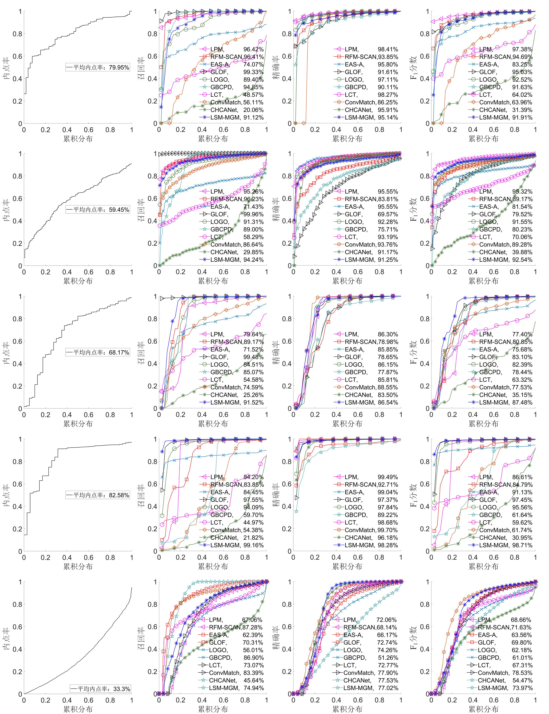
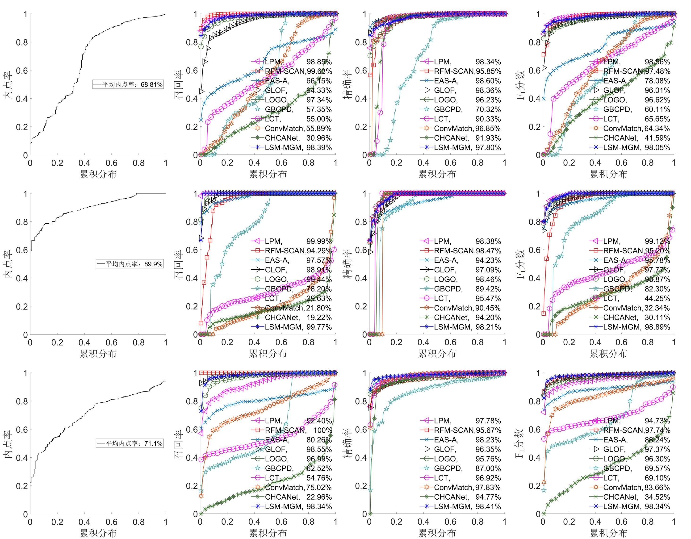

# LSM-MGM
The code for the fast implement of the paper "An Improved Neighborhood-based Mismatch Removal Algorithm for Consumer Device". Please cite the following paper if you use the code in this repository as part of a published research project.
Successfully test on Matlab R2019b.

## An Improved Neighborhood-Based Mismatch Removal Algorithm for Consumer Device
 Haotian Zhang , Wenlong Hou, Ning Jia , and Weidong Zhao 
[DOI 10.1109/TCE.2024.3409774](https://ieeexplore.ieee.org/document/10549964/)

## Usage
We have provided an example with tuned initialization and parameters for LSM-MGM in example.m. Directly running example.m would give the result.

## The comparative test codes
 LPM: https://github.com/jiayi-ma/LPM. and https://github.com/jiayi-ma/LPM-GC.
 GLOF: https://github.com/gwang-cv/GLOF.
 RFM-SCAN: https://github.com/StaRainJ/RFM-SCAN.
 EAS-A: https://github.com/AoxiangFan/EifficientDeterministicSearch.
 LOGO: https://github.com/XiaYifan1999/LOGO.
 GBCPD: https://github.com/ohirose/bcpd.
 LCT: https://github.com/gwang-cv/LCT.
 ConvMatch: https://github.com/SuhZhang/ConvMatch/tree/convmatch_plus.
 CHCANet: https://github.com/gwang-cv/CHCANet.

### Other comparison results with algorithm LSM-MGM

  

 The rows in the figure, from top to bottom, correspond to the image sets DAISY, DTU, VGG, HEINLY, and MegaDepth1500. The columns, from left to right, show the cumulative distributions of the inlier ratio, recall, precision, and F1 score, respectively.
 
 

  

 The rows in the figure, from top to bottom, correspond to the image sets RS, Print, and FIRE. The columns, from left to right, show the cumulative distributions of the inlier ratio, recall, precision, and F1 score, respectively.

## Datasets
 DAISY: https://www.epfl.ch/labs/cvlab/software/descriptors-and-keypoints/daisy/
 DTU: https://roboimagedata.compute.dtu.dk/
 VGG: https://www.robots.ox.ac.uk/~vgg/research/affine/
 HEINLY: https://www.cs.unc.edu/~jheinly/binary_descriptors.html
 MegaDepth1500: https://www.cs.cornell.edu/projects/megadepth/ and https://cvg-data.inf.ethz.ch/megadepth/
 RS: https://github.com/jiayi-ma/GLPM/tree/master
 FIRE: https://www.ics.forth.gr/cvrl/fire/
 Print: The images obtained in "Print" dataset  are sourced from a private engineering project.
 SMVS: https://exhibits.stanford.edu/data/catalog/rb470rw0983
